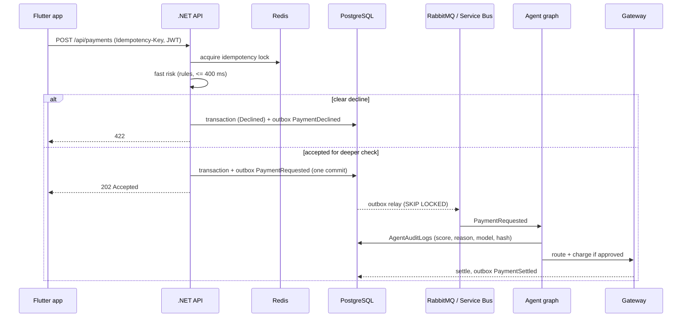

# Architecture notes

## Request flow (Hybrid mode)

## Security and compliance map
| Concern | Where |
|---|---|
| A01 broken access control | owner checks in handlers and queries; "Ops" role policy on log/audit endpoints |
| A02 crypto failures | pinned TLS in client; Keychain/Keystore; managed identity to Azure OpenAI and Service Bus |
| A03 injection | EF parameterised queries; model output is a whitelisted filter, never SQL |
| A04 insecure design | transactional outbox, idempotency keys, fail-closed options, rate limits |
| A05 misconfiguration | security headers, no stack traces to clients, secrets from env or Key Vault |
| A07 auth failures | JWT validation incl. issuer, audience, lifetime; biometric confirmation per payment |
| A09 logging failures | structured rotating logs, correlation id everywhere, immutable agent audit table |
| PII | pseudonymous owner id; no names or card numbers stored; masking enricher; agents see features only |
| ADA / WCAG | semantic labels, live regions, 48 dp targets, text scaling, icon + text status |

## Failover (infra/azure, infra/aws stubs)
Azure Front Door + Application Gateway front the API. AWS holds a warm standby (API, Postgres read replica via logical replication, Amazon MQ or a shared Service Bus namespace). Front Door health probes shift traffic to the AWS origin when Azure is unhealthy.
