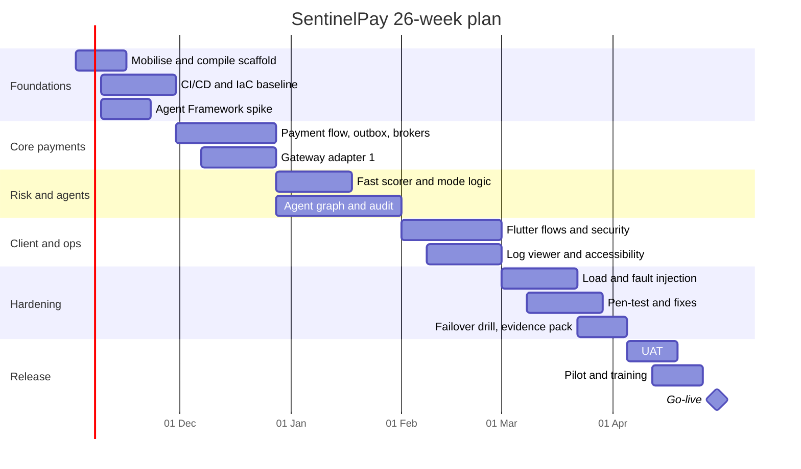

# Project Schedule (26 weeks)

Assumed start **Monday 2 November 2026**; go-live **Friday 30 April 2027**. Replace dates when the real start is fixed. The year-end holiday falls in week 8; the plan keeps that week light.

## 1. Phases and milestones
| Phase | Weeks | Dates | Exit milestone |
|---|---|---|---|
| P1 Foundations | 1-4 | 2 Nov - 27 Nov | M1: scaffold builds, CI/CD live, agent spike decision |
| P2 Core payments | 5-8 | 30 Nov - 25 Dec | M2: payment flow end to end with outbox and one gateway |
| P3 Risk and agents | 9-13 | 28 Dec - 29 Jan | M3: all four risk modes, agent graph, audit store |
| P4 Client and operations | 14-17 | 1 Feb - 26 Feb | M4: client feature-complete, log viewer, accessibility pass 1 |
| P5 Hardening | 18-22 | 1 Mar - 2 Apr | M5: pen-test closed, load and fault tests passed, failover drill |
| P6 Release | 23-26 | 5 Apr - 30 Apr | M6: UAT signed, pilot live, go-live |

## 2. Gantt

## 3. Critical path
Agent Framework spike (W3-4) -> agent graph (W9-13) -> load and fault tests including the agent stage (W18-20) -> pen-test remediation (W19-22) -> UAT (W23-24) -> pilot (W25-26) -> go-live. A one-week slip on any of these moves go-live unless recovered from the 10% contingency in labor or by descoping a Should-have.

## 4. Float and buffers
Client work (P4) has about 2 weeks float against the log-viewer and accessibility tasks. A **1-week schedule buffer is held inside week 24** and is not pre-allocated.

## 5. Dependencies
Gateway sandbox access (week 5); cloud subscriptions (week 2); pen-test vendor booked by week 10 for a week-19 start; pilot customer confirmed by week 20; identity provider tenant by week 6.

## 6. Control
Weekly progress update; SPI and CPI from the cost model monthly (amber below 0.95, red below 0.90); milestone gates M1-M6 need product owner sign-off; re-baseline only through change control.
