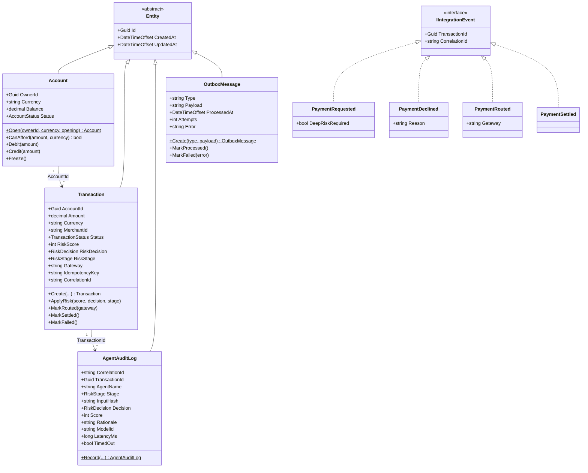
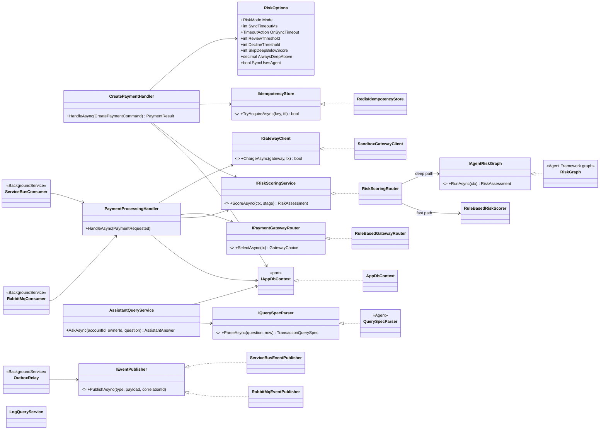
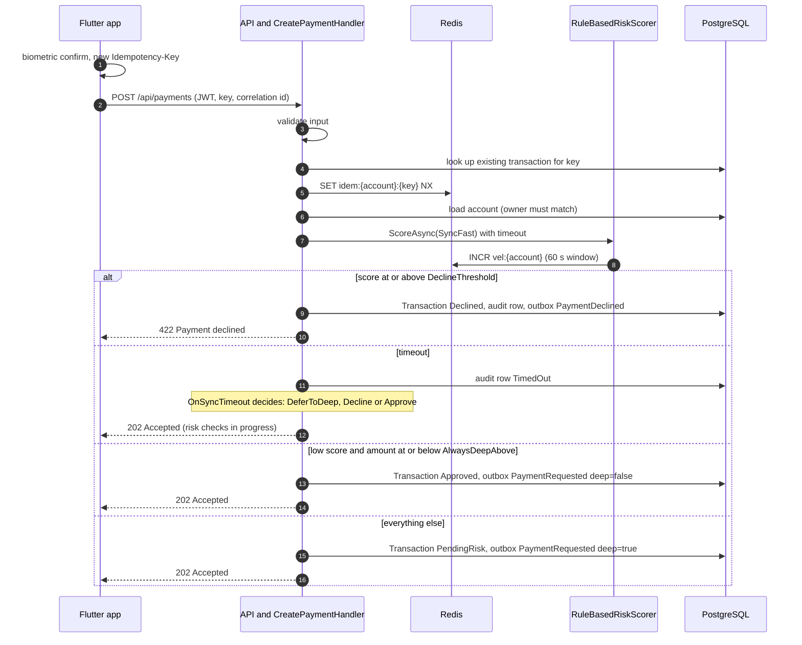
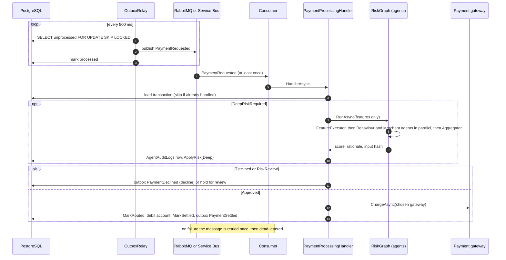
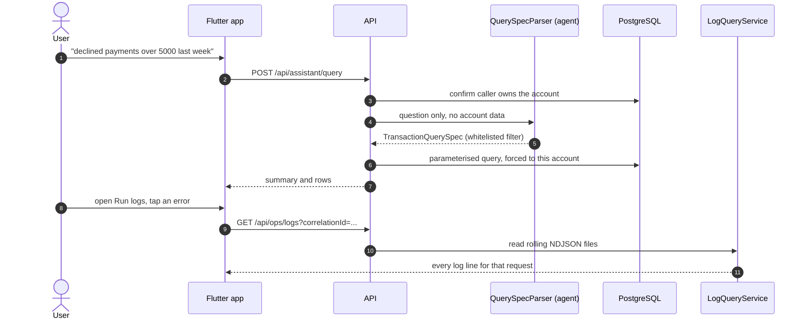
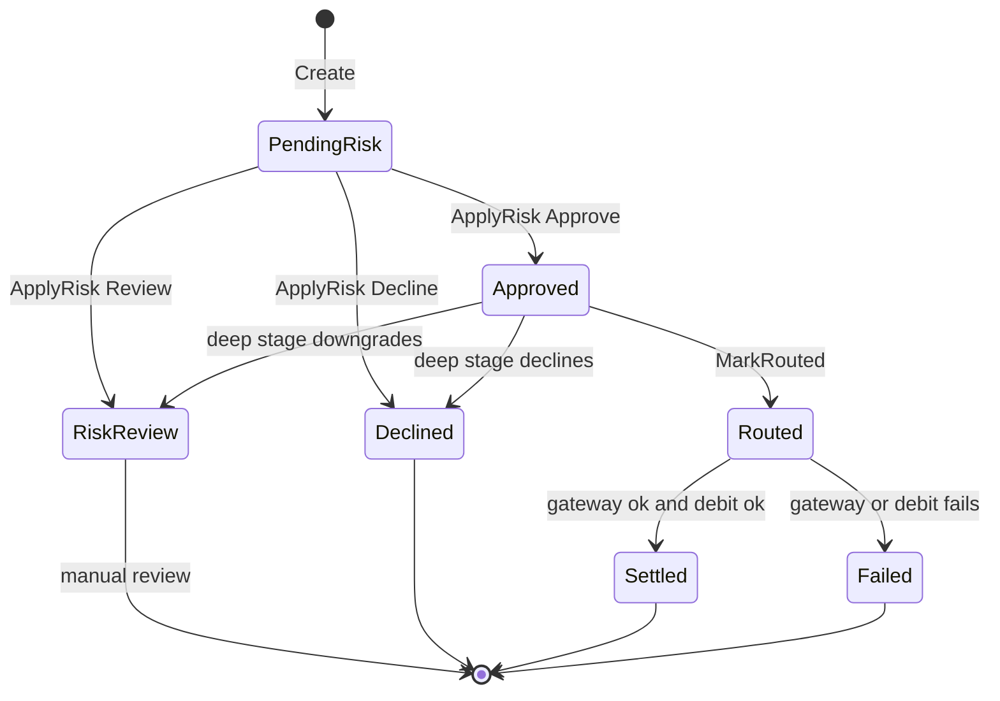
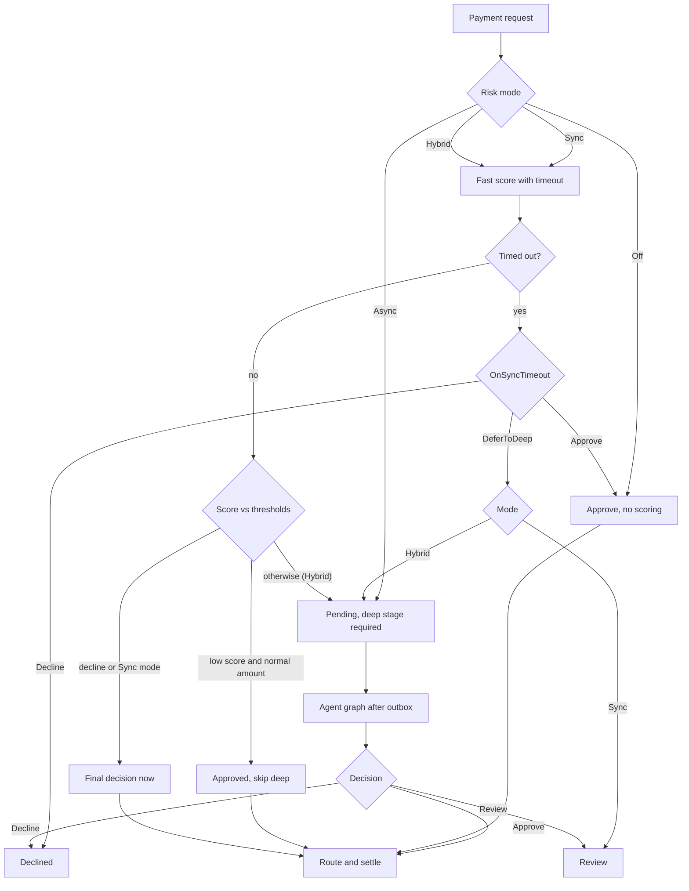
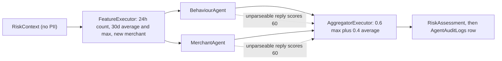

# SentinelPay: class, sequence and workflow diagrams

Every name below comes from the scaffold in `sentinelpay-scaffold.zip`. Each block is plain Mermaid, so you can paste it into GitHub, Medium (via image export) or an IEEE figure.

## 1. Class diagram: domain model

## 2. Class diagram: application, ports and adapters

## 3. Sequence: create a payment (Hybrid mode)

## 4. Sequence: outbox, agents, gateway, settlement

## 5. Sequence: natural-language query and log trace

## 6. Workflow: transaction lifecycle

## 7. Workflow: choosing the risk path

## 8. Workflow: agent graph

